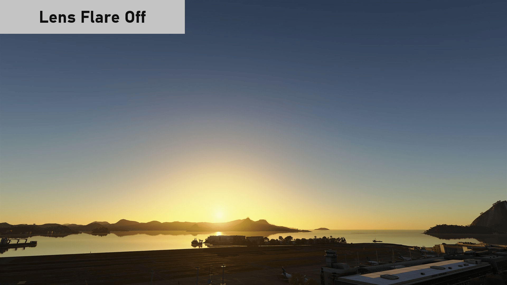
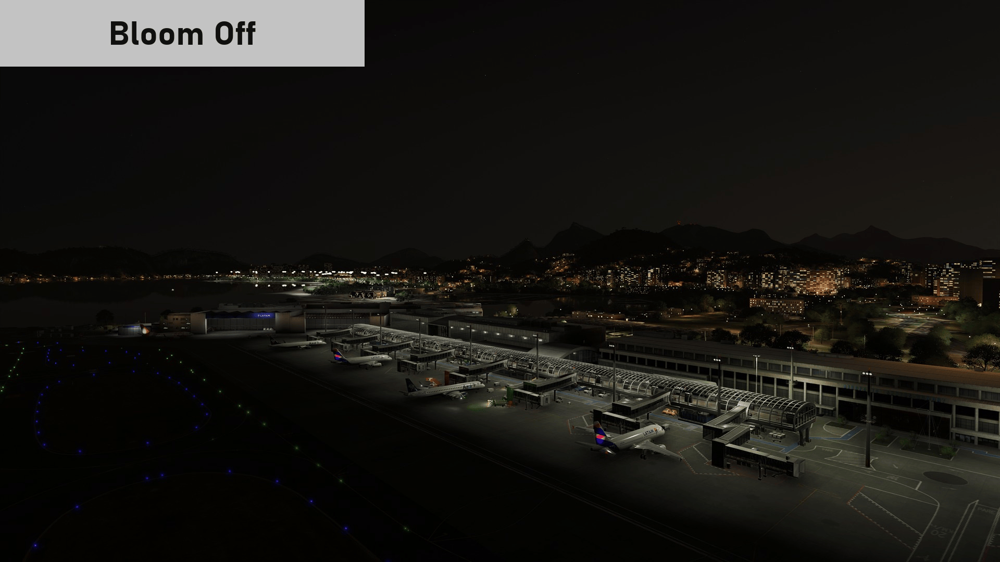

# MSFS 2024 Camera FX Off

By **PdPanoo**

> [!NOTE]
> **This add-on is in beta.** Please report any problem, and send any feedback, through the [GitHub issues](https://github.com/joaobettu/msfs2024-camera-fx-off/issues). Attaching `msfs2024-camera-fx-off.log` from the game folder helps a lot.

A ReShade add-on that removes the "filmed with a camera" look from Microsoft Flight Simulator 2024:

- **Lens flare:** the star rays and lens ghosts the game draws when the sun is on screen go away. The glow around the sun stays by default, and each of the three parts can be kept or removed from the overlay.
- **Bloom and lens dirt:** tonemapping uses the game's own permutation **without bloom**, the same one the engine would use with bloom turned off. Lens dirt only exists together with bloom, so it goes away too.

City, airport and aircraft lights are left alone.

## Before and after

Each GIF alternates between the sim's own look ("On") and the look with the add-on and its default settings ("Off").

**Lens flare.** The star rays and the ghosts are gone, and the glow around the sun stays.



**Bloom.** The halos around the lights are gone, and so is the lens dirt that comes with bloom.



Still images: lens flare [on](docs/images/lens_flare_on.jpg) and [off](docs/images/lens_flare_off.jpg); bloom [on](docs/images/bloom_on.jpg) and [off](docs/images/bloom_off.jpg).

## Requirements

- ReShade 6.8 or newer, the version **with full add-on support**.
- Microsoft Flight Simulator 2024 (DirectX 12). Tested with the Steam version.
- Works alongside other add-ons, such as *Glass Cockpit DLSS Fix*.

## Installation (with the sim closed)

Get the two files from the [latest release](https://github.com/joaobettu/msfs2024-camera-fx-off/releases), or from `build\` if you build the add-on yourself. Copy them into the game folder, the one that holds `FlightSimulator2024.exe` and ReShade's `dxgi.dll` (for the Steam version, `steamapps\common\Limitless`):

- `msfs2024-camera-fx-off.addon64`
- `msfs2024-camera-fx-off.twins` (the shader pairs for the bloom removal; without it, only the lens flare removal works)

To uninstall, delete those files and the ones the add-on creates next to them (`.ini`, `.log`, `.trace.txt`).

## Usage

| Shortcut | Action |
|---|---|
| Ctrl+Shift+F5 | turns the lens flare removal on or off |
| Ctrl+Shift+F6 | turns the bloom removal on or off |
| Ctrl+Shift+F7 | records a one-frame trace to `msfs2024-camera-fx-off.trace.txt` |

The same options are in the ReShade overlay, **Add-ons** tab, along with counters per second.

### Keeping part of the lens flare

The sim's lens flare has three parts. Under the lens flare option, the overlay has a checkbox to keep each one:

| Part | Kept by default | What it is |
|---|---|---|
| Glow around the sun | yes | the soft halo around the sun, without which the sun at noon is just a white dot |
| Star rays | no | the star-shaped rays on the sun |
| Lens ghosts | no | the reflections of the lens along the line from the sun through the center of the screen |

A kept part is still drawn while the rest of the lens flare is removed. Turning the lens flare removal off brings all three back.

Bloom also draws some glow around the sun. Turning the bloom removal off brings it back, along with the lens dirt.

### Settings file

Your choices are saved in `msfs2024-camera-fx-off.ini`, next to the add-on, in the `[settings]` section. The add-on reads it when the sim starts and rewrites it whenever you change an option in game, so edit it by hand only with the sim closed.

| Key | Default | Meaning |
|---|---|---|
| `sun_flare_off` | `1` | remove the lens flare |
| `keep_glow`, `keep_star`, `keep_ghosts` | `1`, `0`, `0` | parts of the lens flare to keep while it is removed |
| `bloom_off` | `1` | remove bloom and lens dirt |
| `key_flare`, `key_bloom`, `key_trace` | `116`, `117`, `118` (F5, F6, F7) | shortcut keys, pressed with Ctrl+Shift, as Windows virtual-key codes |
| `pak_path` | (empty) | full path of the game's `SHADERSPAK.*.SM6.PC.PAK`, if it is not in the `Shaders` folder next to the game executable |

Keys from earlier versions (`flare_keep`, `light_glow_off`, `light_point_off`) are ignored, and removed from the file the next time you change an option.

The log, `msfs2024-camera-fx-off.log`, is rewritten every time the sim starts. It shows:

- the tonemaps that got their no-bloom twin;
- the shaders of each lens flare element, and which part of the lens flare it draws.

## Performance

The add-on's own work per frame is small: a few lookups per pipeline bind and draw (see "Cost per frame" below).

Removing the effects saves the GPU some work instead:

- it no longer blends the lens flare quads over the full-resolution image;
- the tonemap pass no longer reads the bloom and lens dirt textures.

In testing at 3840x2160 on an RTX 4070, turning the removals on gained about 1 FPS. The gain depends on resolution and GPU, and is small: the passes that build the bloom still run, because only the final tonemap is swapped.

## After a sim update

The lens flare is recognized from the context of each draw, not by shader hash, so its removal should keep working.

Its three parts, though, are told apart by their shaders. If an update changes those shaders, the add-on falls back to the order the engine draws them in: the glow first, then the star rays, then the ghosts. The log says when that happens ("has shaders this version does not know"). If the parts come out wrong after an update, please open an issue.

The bloom removal depends on a table of pairs made for the current shader package. If the sim updates, the log and the overlay say so, and bloom simply stays on. To regenerate the table, run this from the source folder (pass `-GamePath` if the game is not in `D:\SteamLibrary\steamapps\common\Limitless`):

```
powershell -ExecutionPolicy Bypass -File tools\gen_twins.ps1 -GamePath "<game folder>"
```

Then copy the new `build\msfs2024-camera-fx-off.twins` into the game folder. The tool only reads the game files, and it refuses to write the table if any pair is ambiguous.

## How it works

Everything is done through ReShade events, with no hooks of its own.

- **Lens flare:** after upscaling (DLSS/FSR/TAA) and before post-processing, the engine has a `do_flare` pass.
  - Each element of the flare is drawn there as a quad (a 4-vertex `draw`) with the generic material shaders (`vh_base`/`ph_base`).
  - The target is the HDR image (R11G11B10), with no depth bound.
  - The add-on skips exactly those draws, except for the parts set to keep.
  - The same shaders draw transparent geometry in the main pass, but always with depth bound, so those draws are left alone.
  - The 24 quads come from 5 pairs of shaders: one for the glow, one for the star rays and three for the ghosts. The add-on knows them by digest, with the draw order as a fallback.
- **Bloom:**
  - Of the 770 `ph_tonemapping` permutations in the `SHADERSPAK`, 384 have bloom. All of them, and only them, bind the lens dirt texture at `t8`.
  - Each one has a no-bloom twin: the same resources minus `t8`/`s8`, and the same code minus the bloom block.
  - `tools\gen_twins.ps1` pairs them offline, with a sequence diff of the DXIL disassembled by the game's own `dxcompiler.dll`.
  - When the game creates a tonemap with bloom, the add-on reads the twin from the package, checks its digest, and creates an identical pipeline with it. Each time the game binds the original, the add-on binds the twin.
- **Lights:** the glow of each distant light is a `vh_billboard_lights` sprite with a `FlareUV` output. The star rays are part of that same sprite, so skipping the draw would erase the whole light. That is why the add-on leaves it alone.
- **Cost per frame:**
  - a lock-free table lookup on every pipeline bind;
  - a format lookup on every render target bind without depth;
  - one test per draw.
- **One-time cost:** the first time each tonemap with bloom is created, the driver compiles its twin. That takes about 65 ms, once.

## Known limitations

- The sim compiles some tonemap permutations at run time. Those are not in the `SHADERSPAK`, so they have no twin and keep their bloom. The log shows "no pair for tonemapping variant" for them. In the main view tested, every tonemap in use had a twin.
- The star rays on lights remain, because they are part of the sprite that draws the light itself.

## Building and testing

You need the Visual Studio 2022 Build Tools (C++ x64) and the Windows 11 SDK.

```
powershell -ExecutionPolicy Bypass -File scripts\build.ps1 -Tests
powershell -ExecutionPolicy Bypass -File tools\gen_twins.ps1
powershell -ExecutionPolicy Bypass -File scripts\test.ps1
```

The scripts default to the game in `D:\SteamLibrary\steamapps\common\Limitless`. If yours is elsewhere, pass:

- `-GamePath` to `gen_twins.ps1` and `test.ps1`;
- `-ReShadeDll` (the path of ReShade's `dxgi.dll`) to `build.ps1`.

What the tests cover:

- `classify_test` runs against the real `SHADERSPAK`, read-only.
  - It checks the counts: 770 tonemaps, 384 of them with bloom. These are the counts for the shader package the add-on was tested with (`SHADERSPAK.d5d2118d.SM6.PC.PAK`); a sim update may change them.
  - It checks that the 5 lens flare elements the add-on knows are in that package, as `vh_base`/`ph_base` pipelines, each with its part.
  - It validates every pair in the table.
  - It fuzzes the parsers with the end of the buffer right against an inaccessible page, so any out-of-bounds read breaks the test.
- `fixture` loads a copy of ReShade's `dxgi.dll` with the add-on, on a D3D12 device on WARP (CPU only). It draws stand-ins for the MSFS shaders, with the same names and signatures, and checks the pixels:
  - a lens flare of 4 quads on an HDR target without depth: unknown shaders, so the add-on goes by draw order, and each part is kept or removed as set;
  - the same quad with depth bound, and a 3-vertex draw, are kept;
  - the lights are kept, even with the old diagnostic keys in the settings;
  - the tonemap is swapped for its twin.
- An extra `fixture` run builds a pipeline from the game's own bloom tonemap shader, taken from its package. It checks that the add-on creates the real no-bloom twin. That pipeline is only compiled, never drawn.
- `scripts\test.ps1 -Gpu` runs the `fixture` on the graphics card. While the sim is running, it only does so with `-Force`.

## Credits and license

- Author: PdPanoo. Bug reports and suggestions are welcome in the [issues](https://github.com/joaobettu/msfs2024-camera-fx-off/issues).
- License: MIT, see [LICENSE](LICENSE).
- Third-party code, under its own licenses:
  - ReShade 6.8.0 add-on SDK headers (`third_party/reshade`): BSD-3-Clause OR MIT, © Patrick Mours. See `third_party/reshade/LICENSE.txt`.
  - Dear ImGui 1.92.5 (`third_party/imgui`): MIT, © Omar Cornut. See `third_party/imgui/LICENSE.txt`.

This project is not affiliated with or endorsed by Microsoft, Asobo Studio or the ReShade project.
